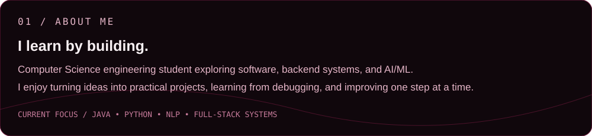
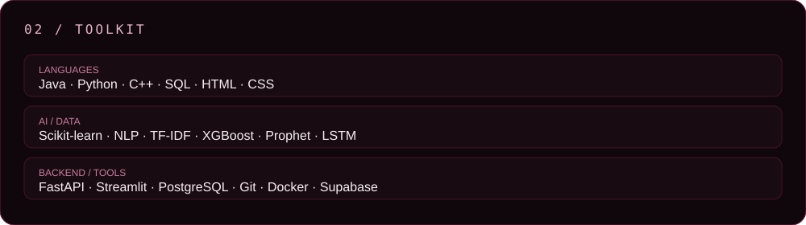
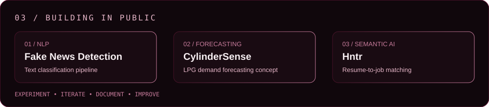

### AI/ML Engineer · Software Developer · Backend Developer

Building practical software with Python, Java, machine learning, and thoughtful product engineering.

📍 Karnataka, India

[GitHub](https://github.com/AafaqAaf) · [LeetCode](https://leetcode.com/u/6Q4GynQHXq/) · [LinkedIn](https://www.linkedin.com/in/mohammed-aafaq/)

---

## About me

I'm Mohammed Aafaq, a Computer Science and Engineering student interested in AI/ML, backend systems, and building useful applications. I enjoy learning by making projects, debugging real problems, and connecting software engineering with practical use cases.

Currently exploring machine learning, NLP, APIs, databases, and full-stack development.

## Featured projects

| Project | Overview | Link |
|---|---|---|
| **Fake News Detection using NLP** | Classifies news using NLP features and machine-learning models, including TF-IDF-based approaches. | [View repository](https://github.com/AafaqAaf/Fake-news-detection-using-NLP) |
| **Stock Price Predictor** | Streamlit-based stock prediction project exploring historical market data and LSTM forecasting. | [View repository](https://github.com/AafaqAaf/Stock-price-predictor) |
| **CylinderSense** | AI-powered LPG demand forecasting and allocation concept developed for a hackathon. | [Browse my repositories](https://github.com/AafaqAaf?tab=repositories) |
| **Hntr — Job Matching Extension** | Browser-extension concept for semantic resume-to-job matching using embeddings. | [Browse my repositories](https://github.com/AafaqAaf?tab=repositories) |
| **KSRTC Tracker** | Public-transport tracking project exploring live bus tracking and a multi-app architecture. | [Browse my repositories](https://github.com/AafaqAaf?tab=repositories) |

## Technical interests

- **Languages:** Python, Java, C++, SQL, HTML, CSS
- **AI / ML:** scikit-learn, NLP, TF-IDF, XGBoost, LSTM, Sentence Transformers
- **Backend & data:** FastAPI, PostgreSQL, Redis
- **Apps & tools:** Streamlit, Git, GitHub, Docker

These are technologies I've worked with or explored across coursework and projects; depth of experience varies by tool.

## GitHub activity

View my live contribution history directly on [my GitHub profile](https://github.com/AafaqAaf). Contribution counts and activity update on GitHub; no statistics are fabricated or hard-coded here.

## Connect

- GitHub: [@AafaqAaf](https://github.com/AafaqAaf)
- LeetCode: [AafaqAaf](https://leetcode.com/u/6Q4GynQHXq/)
- LinkedIn: [Mohammed Aafaq](https://www.linkedin.com/in/mohammed-aafaq/)

---

Designed with a midnight, burgundy, rose, and ivory visual system. Built with GitHub-compatible Markdown and SVG assets.
